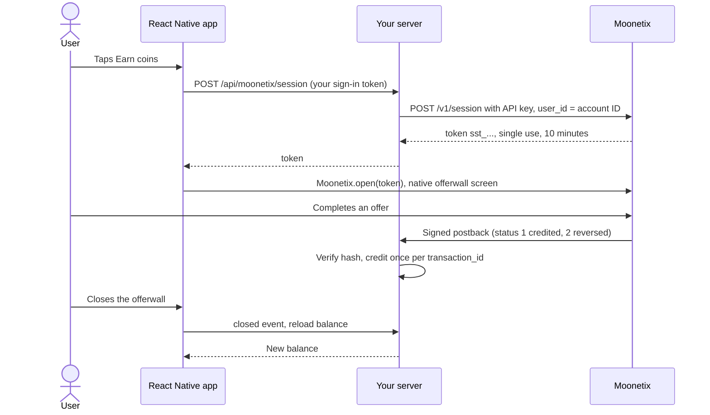

# React Native Offerwall Example

**A React Native app (Expo development build) that opens the Moonetix offerwall in a native screen, with a small server that creates sessions and credits rewards from verified postbacks.**

[](https://github.com/moonetix/offerwall-react-native-example/actions/workflows/ci.yml)
[](LICENSE)
[](https://docs.moonetix.com/react-native-sdk)
[](https://moonetix.com/register?from=github-offerwall-react-native-example)
[](https://moonetix.com/integrations/react-native)
[](https://moonetix.com/academy/integrations/react-native-offerwall)

An Android and iOS app built with the [Moonetix](https://moonetix.com) `@moonetix/react-native-offerwall` package, plus a Node.js server in `server/`. Moonetix is an affiliate network: your users earn your own currency by completing offers, and you earn per completed offer. The JavaScript bundle holds no key. Your server creates a single-use session for the signed-in user, and only your server changes balances.

> **Get your App ID and keys: sign up free at https://moonetix.com/register?from=github-offerwall-react-native-example**

## What you get

1. **The documented Earn button in a real app.** Sign-in, balance, reward history, a token fetched on every tap, `Moonetix.open(token)`, a balance reload on the `closed` event, and the button hidden where `Moonetix.isSupported` is false. The package calls follow the [React Native SDK docs](https://docs.moonetix.com/react-native-sdk).
2. **Expo without ejecting.** The config plugin in `app.json` adds the Moonetix Maven repository and the iOS SDK during `npx expo prebuild`, so the repo carries no native folders. Bare React Native 0.77+ projects copy `src/` as is.
3. **Client and server tested together.** The app's API client runs against the real server in the tests, next to server tests that replay postbacks produced by the Moonetix signing code.

## How it fits together



## Quick start

You need Node.js 22.13 or later, Android Studio or Xcode 16+, a device or emulator, and an approved Moonetix app. The offerwall does not open in Expo Go, which cannot load native code; this project runs as a development build.

**1. Start the server**

```bash
git clone https://github.com/moonetix/offerwall-react-native-example.git
cd offerwall-react-native-example
cp server/.env.example server/.env   # paste your API key and postback secret key
npm run server                       # http://127.0.0.1:3000, leave it running
```

**2. Build and run the app** (second terminal)

```bash
cp .env.example .env                 # paste your App ID
npm install                          # .npmrc points @moonetix at https://moonetix.com/npm/
npm run android                      # or: npm run ios (macOS)
```

`npm run android` and `npm run ios` run `expo prebuild` and build a development client. After that, `npm start` is enough for JavaScript changes. Rebuild after you add or update a native package: a Metro reload does not add native code.

`EXPO_PUBLIC_API_URL` is your server. `http://10.0.2.2:3000` reaches your computer from the Android emulator. On the iOS Simulator use `http://localhost:3000`. On a phone, set `HOST=0.0.0.0` in `server/.env` and use your computer's LAN address, or a public https host.

**3. Connect Moonetix** in your dashboard:

1. Copy the App ID from the top of your offerwall's settings page into `.env`.
2. Copy the API key from the API page into `server/.env` as `MOONETIX_API_KEY`.
3. On the Postback page, copy the postback secret key into `server/.env` as `MOONETIX_POSTBACK_KEY`, and save this postback URL:

```
https://YOUR_HOST/moonetix/postback?user={user_id}&tx={transaction_id}&event={event_id}&status={status}&reward={reward}&payout={payout}&offer={offer_name}&hash={hash}
```

| Setting | Where | Default | What it is |
| --- | --- | --- | --- |
| `EXPO_PUBLIC_MOONETIX_APP_ID` | `.env` (app) | none, required | App ID, 24 lowercase hex characters. Public. |
| `EXPO_PUBLIC_API_URL` | `.env` (app) | `http://10.0.2.2:3000` | Your server. Use https in production. |
| `MOONETIX_API_KEY` | `server/.env` | none, required | API key for `POST /v1/session`. Server only. |
| `MOONETIX_POSTBACK_KEY` | `server/.env` | none, required | Postback secret key. Server only. |
| `PORT` | `server/.env` | `3000` | HTTP port |
| `HOST` | `server/.env` | `127.0.0.1` | Bind address. `0.0.0.0` to reach the server from a phone. |
| `DATABASE_PATH` | `server/.env` | `./data.sqlite` | SQLite file for accounts, sign-in tokens and transactions |
| `CURRENCY_NAME` | `server/.env` | `Coins` | Currency label in `/api/me` |
| `SESSION_DAYS` | `server/.env` | `30` | How long a sign-in token stays valid |

Expo copies every `EXPO_PUBLIC_` value into the bundle, which is why the keys live in a separate file under `server/`.

**Bare React Native.** Add `@moonetix:registry=https://moonetix.com/npm/` to `.npmrc`, run `npm install @moonetix/react-native-offerwall` and `pod install` in `ios/`, and copy `src/` and the `Moonetix.init` call from `App.tsx`. If your `settings.gradle` sets `repositoriesMode` to `FAIL_ON_PROJECT_REPOS` or `PREFER_SETTINGS`, add `maven { url = uri("https://moonetix.com/maven") }` there.

## How it works

1. `App.tsx` calls `Moonetix.init` once, with the App ID, when the bundle loads.
2. The user signs in or creates an account on your server (`POST /api/register`, `POST /api/login`). Creating an account needs the "I am 16 or older" switch. The server stores a scrypt password hash and only the SHA-256 of each sign-in token.
3. The home screen loads the balance and recent rewards from `GET /api/me`, again when the app returns to the foreground, and on pull to refresh.
4. When the user taps Earn coins, the app calls `POST /api/moonetix/session` with its sign-in token. The server calls `POST https://api.moonetix.com/v1/session` with the API key and the account ID as `user_id`, and returns only the `token`. Any user ID in the request body is ignored.
5. On 403 (`app_not_live`, `user_blocked`) the server answers 403, on anything else 503, and the app shows "The offerwall is not available right now."
6. The app calls `Moonetix.open(token)`. A new token is fetched on every tap, because a token works once and for 10 minutes.
7. Moonetix calls `GET /moonetix/postback`. The server checks the hash first, credits on status 1 once per `transaction_id`, takes back the stored amount on status 2, and answers 200 only after the change is stored.
8. On the `closed` event the app reloads the balance. Events only refresh the screen. They never add coins.

| File | Purpose |
| --- | --- |
| `App.tsx` | `Moonetix.init`, signed-in or signed-out screen |
| `src/EarnButton.tsx` | Earn button, event listeners, `Moonetix.open` |
| `src/api.ts` | Calls to your server: sign-in, balance, token |
| `src/HomeScreen.tsx`, `src/SignInScreen.tsx` | Screens |
| `app.json` | Expo config with the Moonetix config plugin |
| `server/src/server.js` | HTTP routes |
| `server/src/moonetix.js` | `POST /v1/session` call, postback hash, amounts |
| `server/src/postback.js`, `store.js` | Postback handling and SQLite storage (`node:sqlite`) |

## Security notes

- The API key and the postback secret key are read from environment variables on the server. Never put them in `.env` at the root, the bundle, or Git. Anyone can read strings out of a JavaScript bundle.
- The App ID is public. It is not the API key, and passing the API key to `Moonetix.init` gives `INVALID_APP_ID`.
- The session endpoint creates a token only for the account of the sign-in token. The user ID never comes from the app.
- The postback hash is checked with `crypto.timingSafeEqual` before anything else. Tampered or wrongly signed postbacks get 403.
- `transaction_id` is the primary key of the transactions table, so a retry cannot credit twice. Credit and balance change run in one database transaction.
- A reversal subtracts the stored credited amount, only for a transaction credited to the same account. Balances can go below zero after a reversal; say in your terms that rewards can be taken back.
- `payout`, `offer` and `event` are not signed. They are used for display and logs, never for money.
- Sign-in and sign-up are rate limited per address. The sign-in token is kept in memory in this example; use `expo-secure-store` or the Keychain and Keystore if you keep users signed in.
- Reward users only for completed offers. Never reward ratings, reviews, installs of your own app, invites or other engagement. Users must be 16 or older. Keep the offerwall optional and out of apps for children.
- Declare the data the offerwall collects in App Store Connect and in Google Play's Data safety form. The list is in the [React Native SDK docs](https://docs.moonetix.com/react-native-sdk).

## Test it

```bash
npm test             # server tests, then the app's API client against the real server
npm run typecheck    # tsc --noEmit
```

No network and no Moonetix account needed. The server tests check accounts and sign-in, that the session is created for the signed-in account and never for a user ID the app sends, the exact `POST /v1/session` request against a local stand-in for Moonetix, and they replay postbacks produced by the Moonetix signing code with test keys (`server/test/fixtures/moonetix-vectors.json`): credit, retry, decimal rewards, another user's credit, reversal, repeated reversal, reversal of a never-credited `test_` transaction, unknown users, and tampered or wrongly signed postbacks. `test/api.test.ts` runs `src/api.ts` against the same server: sign-up with and without the 16+ confirmation, a token per tap, balance and history after a postback, a 403 from Moonetix, and sign-out.

**Against the running server**

The postback route can also be checked from the outside with [postback-tester](https://github.com/moonetix/postback-tester), which signs requests the way Moonetix does. With `npm run server` running and an account created in the app, it sends a credit and its retry, three kinds of reversal, four forged or unsigned postbacks and five parallel copies of one credit:

```bash
export MOONETIX_POSTBACK_KEY=your-postback-secret-key   # same value as in server/.env
npx github:moonetix/postback-tester --preset moonetix \
  'http://127.0.0.1:3000/moonetix/postback?user={user_id}&tx={transaction_id}&event={event_id}&status={status}&reward={reward}&payout={payout}&offer={offer_name}&hash={hash}' --user 1
```

**With Moonetix**

1. Run the development build on an Android phone, an iPhone, or the iOS Simulator, and create a test account. It gets user ID `1` on a fresh database.
2. Tap Earn coins. The offerwall opens in a native screen. Check that an offer opens in the store or the browser, and that back and close return to the app.
3. In the dashboard, open Offerwalls, your offerwall, Integration, and click **Send a test postback** with user ID `1` and status 1. You can also send one from the Postback page. Close the offerwall or pull to refresh: the balance goes up once.
4. A status 2 test uses a new `test_` transaction ID that was never credited, so the server answers 200 and changes nothing. Every attempt is listed under Reports, Postbacks.
5. Test from a normal home or mobile connection. On a VPN or a cloud test device the offerwall shows a block page such as VPN detected.
6. Remove test rewards from your test accounts before launch.

## Troubleshooting

| What you see | Cause |
| --- | --- |
| No Earn coins button | `Moonetix.isSupported` is false: the app runs in Expo Go or on web. Use the development build from `npm run android` or `npm run ios`. |
| `Missing environment variables: ...` when the server starts | `server/.env` is missing or a required key is empty. |
| Sign-in fails with a network error | `EXPO_PUBLIC_API_URL` does not reach the server from this device. Emulator: `10.0.2.2`. Simulator: `localhost`. Phone: `HOST=0.0.0.0` and your LAN address. Restart Metro after editing `.env`: the values are baked into the bundle. |
| "The offerwall is not available right now." and the server logs `moonetix session failed {"status":401,"error":"invalid_api_key"}` | `MOONETIX_API_KEY` is wrong. Every Moonetix failure except 403 reaches the app as 503 `offerwall_unavailable`. A 403 means `app_not_live` or `user_blocked`. |
| Warning `Moonetix: INVALID_APP_ID` | `EXPO_PUBLIC_MOONETIX_APP_ID` is not the 24-character App ID. The API key is the usual mix-up. |
| Postback answers 403 `invalid hash` | `MOONETIX_POSTBACK_KEY` does not match the Postback page. |

## Learn more

- Docs: [React Native SDK](https://docs.moonetix.com/react-native-sdk), [Postbacks](https://docs.moonetix.com/postbacks), [Credits and reversals](https://docs.moonetix.com/credits-and-reversals), [Testing](https://docs.moonetix.com/testing)
- Guide: [How to Add an Offerwall to a React Native App](https://moonetix.com/academy/integrations/react-native-offerwall)
- Guide: [Offerwall postback in Node.js](https://moonetix.com/academy/integrations/offerwall-postback-nodejs)
- Guide: [Test your app before launch](https://moonetix.com/academy/integrations/test-your-app-before-launch)
- Moonetix for React Native: [moonetix.com/integrations/react-native](https://moonetix.com/integrations/react-native)
- Moonetix for apps: [moonetix.com/industries/apps](https://moonetix.com/industries/apps)

## Get started

**Get your App ID and keys: sign up free at https://moonetix.com/register?from=github-offerwall-react-native-example**

Every publisher application is reviewed by hand. Once you are approved, add your app, set your currency name and rate, and paste the keys into `.env` and `server/.env`.

## More Moonetix examples

**Start here**
- [awesome-offerwalls](https://github.com/moonetix/awesome-offerwalls): curated guides, tools and examples for offerwall publishers
- [offerwall-postback-handlers](https://github.com/moonetix/offerwall-postback-handlers): tested postback handlers in PHP, Node.js, Python and Java

**SDKs**
- [moonetix-android-sdk](https://github.com/moonetix/moonetix-android-sdk), [moonetix-ios-sdk](https://github.com/moonetix/moonetix-ios-sdk), [moonetix-flutter](https://github.com/moonetix/moonetix-flutter), [moonetix-react-native](https://github.com/moonetix/moonetix-react-native), [moonetix-unity](https://github.com/moonetix/moonetix-unity)

**Web frameworks and backends**
- [offerwall-nextjs-starter](https://github.com/moonetix/offerwall-nextjs-starter), [offerwall-react-vite](https://github.com/moonetix/offerwall-react-vite), [offerwall-vue-nuxt](https://github.com/moonetix/offerwall-vue-nuxt), [offerwall-express](https://github.com/moonetix/offerwall-express), [offerwall-laravel](https://github.com/moonetix/offerwall-laravel), [offerwall-django](https://github.com/moonetix/offerwall-django)
- [offerwall-firebase-functions](https://github.com/moonetix/offerwall-firebase-functions), [offerwall-supabase](https://github.com/moonetix/offerwall-supabase), [rewards-site-starter](https://github.com/moonetix/rewards-site-starter), [moonetix-offerwall-wordpress](https://github.com/moonetix/moonetix-offerwall-wordpress)

**Apps, games and communities**
- [offerwall-flutter-example](https://github.com/moonetix/offerwall-flutter-example), [offerwall-chrome-extension](https://github.com/moonetix/offerwall-chrome-extension), [offerwall-electron](https://github.com/moonetix/offerwall-electron)
- [offerwall-unity-example](https://github.com/moonetix/offerwall-unity-example), [offerwall-godot](https://github.com/moonetix/offerwall-godot), [offerwall-html5-game](https://github.com/moonetix/offerwall-html5-game)
- [telegram-mini-app-offerwall](https://github.com/moonetix/telegram-mini-app-offerwall), [discord-rewards-bot](https://github.com/moonetix/discord-rewards-bot)

**Tools and data**
- [postback-tester](https://github.com/moonetix/postback-tester): signed test postbacks that catch double credits, missed reversals and forged requests
- [signup-guard](https://github.com/moonetix/signup-guard), [datacenter-ip-ranges](https://github.com/moonetix/datacenter-ip-ranges), [offerwall-fraud-playbook](https://github.com/moonetix/offerwall-fraud-playbook): fake sign-ups, datacenter traffic and reward fraud
- [reward-economy-kit](https://github.com/moonetix/reward-economy-kit), [referral-engine](https://github.com/moonetix/referral-engine), [gamification-kit](https://github.com/moonetix/gamification-kit): points math, referrals and retention
- [affiliate-postback-macros](https://github.com/moonetix/affiliate-postback-macros), [country-tiers](https://github.com/moonetix/country-tiers): postback formats of other networks and country tiers for targeting

## License

MIT. See [LICENSE](LICENSE). The `@moonetix/react-native-offerwall` package is licensed separately under the Apache License 2.0.
